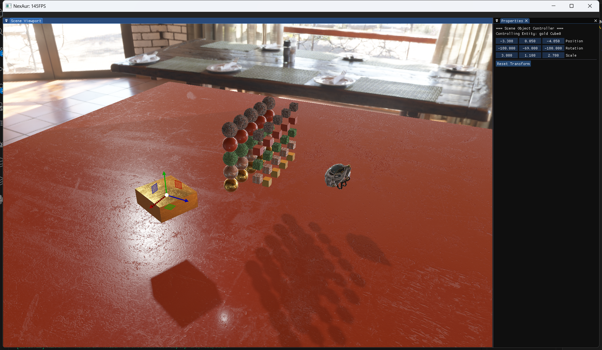
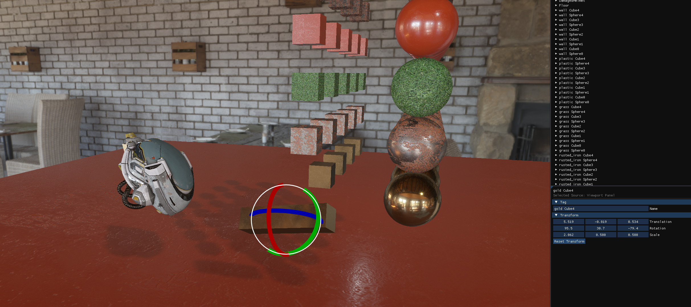

# NexAur

NexAur 是用于学习和研究游戏引擎开发的个人 C++20 项目，包含模块化运行时、ECS 场景、Vulkan 渲染器和内置编辑器。

## 文档入口

- [文档导航与当前进度](docs/README.md)
- [构建、运行与测试](docs/development/build_and_test.md)
- [整体架构](docs/architecture/Architecture.md)
- [Vulkan 渲染架构](docs/architecture/RendererSystem/Renderer.md)
- [开发计划索引](docs/plans/README.md)
- [编码规范](docs/CodingGuideLines/CodingGuideLines.md)
- [资产清单](assets/asset_manifest.md)

## 当前能力

| 领域 | 已实现 |
| --- | --- |
| 引擎基础 | 模块依赖排序、生命周期与服务注册、日志、窗口、输入快照与 InputAction |
| 场景与运行时 | EnTT ECS、JSON 场景保存/加载、基础玩法系统、碰撞触发器、运行时相机、HUD、miniaudio 音频 |
| 资源 | CPU/GPU 资源分离、tinygltf 导入 glTF/GLB、Assimp 补充导入、PBR 材质及运行时材质实例 |
| Vulkan 渲染 | Forward PBR、HDR/ACES、IBL、方向光/点光/矩形光阴影、SSAO、SSR、Reflection Probe、Bloom、SMAA |
| 编辑器 | Dockspace、SceneView/GameView、Hierarchy、Inspector、Project、Console、渲染设置与诊断、拾取和 Gizmo |
| 可选光追 | BLAS/TLAS、Ray Query 方向光阴影、RTAO，以及 RT 反射原始输出 |

当前开发重点为 [RT 反射](docs/plans/Renderer/RayTracing/ray_traced_reflection_foundation_plan.md)：RT-10.0～RT-10.2 已实现，下一工作包为 RT-10.3 时空降噪，随后是 RT-10.4 混合反射合成。RT 反射默认关闭，原始结果通过调试视图查看；完整 Path Tracer 尚未实现。

编辑器的 SceneView/GameView 已区分相机来源，但 Play/Pause/Stop 按钮尚未接入完整运行生命周期。

## 技术栈

- **C++20 / CMake / vcpkg**：当前提供 Windows x64 / Visual Studio 2022 构建预设。
- **Vulkan 1.3 / HLSL / DXC**：使用 dynamic rendering、synchronization2 和 SPIR-V Shader。
- **vk-bootstrap / volk / Vulkan Memory Allocator**：设备初始化、函数加载与 GPU 内存管理。
- **GLFW / Dear ImGui Docking / ImGuizmo**：窗口、输入与编辑器交互。
- **EnTT / glm**：ECS 与数学计算。
- **tinygltf / Assimp / stb_image**：模型、材质贴图和 HDR 图像导入。
- **spdlog / fmt / nlohmann-json / miniaudio**：日志、格式化、序列化与音频。

当前构建只支持 vcpkg 依赖路径与 Vulkan 渲染主线；仓库中的 `external/` 和旧 GLSL 资产不代表仍存在可切换的 OpenGL 后端。

## 快速开始

安装 Visual Studio 2022 C++ 工具链、CMake 3.25+、Vulkan SDK 和 vcpkg，并设置 `VCPKG_ROOT` 后，在仓库根目录执行：

```powershell
cmake --preset msvc-vcpkg
cmake --build --preset msvc-vcpkg-debug
./bin/msvc-vcpkg/Debug/Sandbox.exe
```

依赖、测试选择和常见问题见[构建说明](docs/development/build_and_test.md)。

## 历史截图

以下为开发过程截图，不作为当前渲染质量或 UI 的验收基线。



