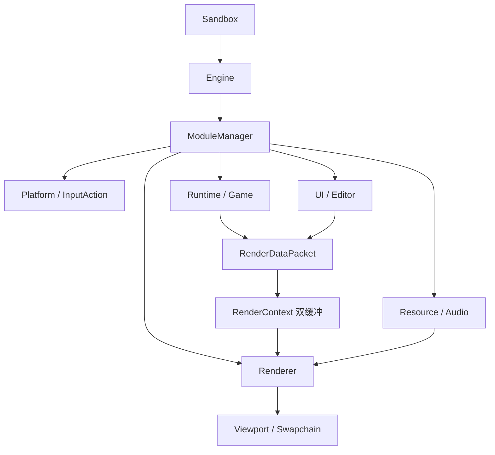

# NexAur 整体架构

最后核对：2026-10-18。本文描述当前 Vulkan 主线；早期迁移方案见[计划索引](../plans/README.md)。

## 模块边界



- Engine 调度应用生命周期和帧阶段。
- Module 拥有系统，ModuleRegistry 按接口类型注册 Service。
- Scene/Resource 保存组件、CPU 数据和资产身份，GPU 对象归 Renderer。
- Editor 通过窄服务操作场景、视口、选择和渲染诊断，不持有 Vulkan 对象。
- `RunTimeGlobalContext` 是模块组合根和兼容桥；深层对象优先使用构造参数或局部 Context。

## 启动与关闭

1. [Sandbox main](../../source/Sandbox/Sandbox.cpp)先识别 smoke 命令；普通启动创建 Engine。
2. [Engine::startEngine](../../source/Engine/engine.cpp)调用全局组合根。
3. [global_context.cpp](../../source/Engine/Function/Global/global_context.cpp)注册 Core、FileSystem、Platform、InputAction、Resource、Audio、RenderContext、Renderer、Runtime、Game、UI、Editor。
4. ModuleManager 根据 dependencies 拓扑排序，依次执行服务注册、初始化和 postInitialize。
5. Engine 绑定窗口事件回调；Sandbox 布置样例场景并进入运行循环。
6. 关闭时按照实际初始化顺序反向释放模块和服务。

## 每帧流程

```text
calculateFPS
  -> tickModules
       Platform 刷新 InputState
       InputAction 计算动作状态
       Audio 更新
       Runtime tick active scene
       Game 更新玩法、触发器、相机与状态
  -> postUpdateModules
       Runtime 提取场景 RenderDataPacket
       Editor 更新；SceneView 覆盖预览相机，GameView 保留场景相机
  -> UIService::beginFrame
  -> renderUIModules
  -> UIService::finalizeFrame
  -> RenderContext::swapBuffers
  -> RendererService::render
  -> WindowService::present / pollEvents
```

这里只列出有业务意义的阶段；实际所有已初始化模块都会收到相应回调。Vulkan renderer 内部提交命令并执行 swapchain present，WindowService 不承担 Vulkan present。

`RenderContext` 的双缓冲用于隔离写入包和读取包，不代表 Engine 已使用独立逻辑/渲染线程。GPU 端另外使用两个 frames in flight。

## 场景、资产与渲染数据

```text
SceneV2 / EnTT
  -> RenderDataPacket（AssetHandle、Transform、Camera、Light、Settings）
  -> RenderSceneFrame（校验和整理后的后端无关帧）
  -> VulkanPreparedFrame / VulkanDrawList（解析 GPU 资源）
  -> VulkanPassGraph / synchronization2
  -> Vulkan Pass / Feature
  -> Viewport / Swapchain
```

- [SceneV2](../../source/Engine/Function/Scene/scene_v2.h)管理实体和组件，并提取渲染数据。
- [SceneSerializer](../../source/Engine/Function/Scene/scene_serializer.h)通过 JSON 保存/加载场景。
- [AssetManager](../../source/Engine/Function/Resource/asset_manager.h)管理 CPU 资产及元数据；当前仍是单例。
- glTF/GLB 使用 tinygltf；其他支持格式由 Assimp importer 处理，解析结果转换为引擎类型。
- GPU buffer、image、descriptor、pipeline 及其生命周期由 Vulkan 后端管理。

## 当前边界

- GameModule 已包含基础玩法、HUD 和状态流程；Physics 当前为轻量碰撞查询与触发器，没有独立注册的完整刚体物理模块。
- 编辑器 SceneView/GameView 只区分视口相机；完整 Play/Pause/Stop 生命周期尚未接通。
- Renderer 以 Vulkan 为唯一主线，Ray Query 按设备能力启用；完整 RT Pipeline/SBT 尚未实现。

## 继续阅读

- [模块生命周期与 Service](ModuleSystem/ModuleSystem.md)
- [Vulkan Renderer](RendererSystem/Renderer.md)
- [Editor](EditorSystem/Editor.md)
- [Input](InputSystem/Input.md)
- [Event](EventSystem/EventSystem.md)
- [Log](LogSystem/Log.md)
